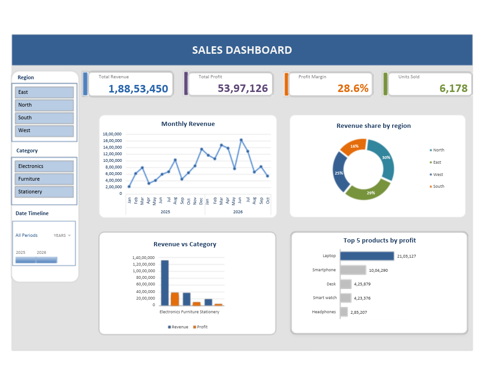

# Sales Performance Dashboard (Excel)

An interactive Excel dashboard that tracks revenue, profit and sales trends
across regions and product categories.

## What it shows
- KPI cards: Total Revenue, Total Profit, Profit Margin %, Units Sold
- Monthly revenue trend (line chart)
- Revenue share by region (doughnut chart)
- Revenue by category (column chart)
- Top 5 products by profit (bar chart)
- Filters: Region slicer, Category slicer and a date Timeline,
  all connected to every chart and KPI

## Dataset
400 sample orders, Jan 2025 - Oct 2026, with Region, Category, Product,
Units, Unit Price, Revenue, Cost and Profit. The data is practice/sample data.

## Key results (all data)
- Revenue: 18,853,450
- Profit: 5,397,126 (28.6% margin)
- Units sold: 6,178

## Skills used
Excel Tables, PivotTables, PivotCharts, GETPIVOTDATA, calculated margin,
date grouping, Top-N filters, slicers, timeline, report connections,
dashboard layout and formatting.

## How to use
Download `Sales_Data_Practice.xlsx`, open the Dashboard sheet, and click the
slicers or timeline to filter every chart at once.
